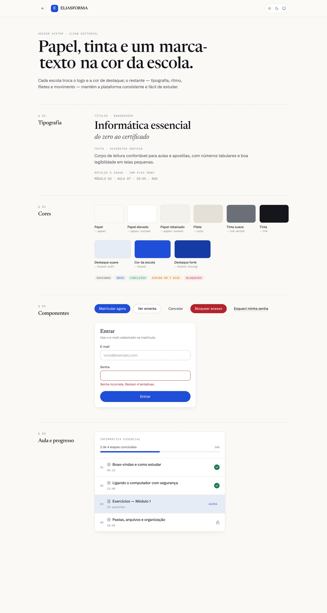
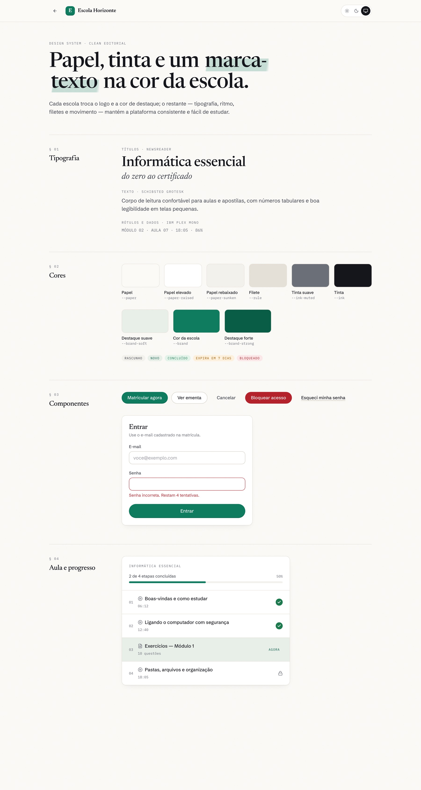
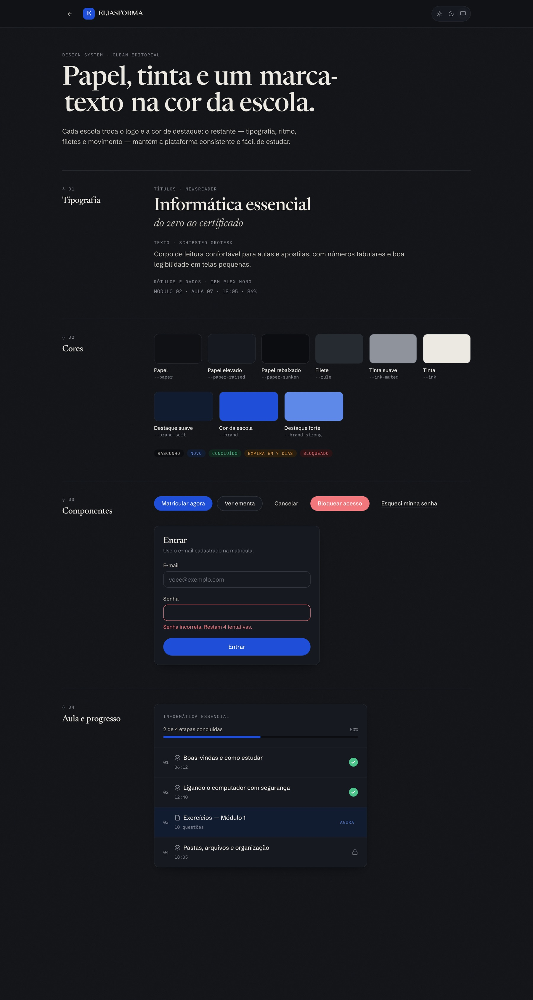
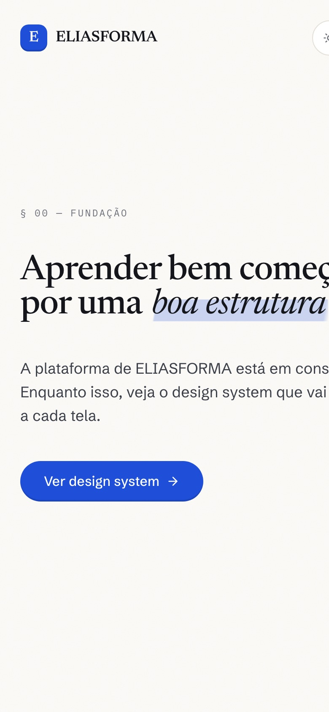
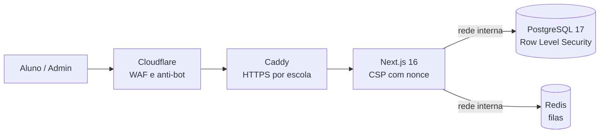

<div align="center">

# ELIASFORMA

**Plataforma de cursos white-label e multi-escola, com segurança como prioridade.**

Cada escola ou empresa recebe sua própria marca, domínio e dados isolados: área do aluno,
editor de cursos, exercícios corrigidos na hora, certificados e painel administrativo completo.

`Next.js 16` · `React 19` · `TypeScript` · `PostgreSQL 17 + RLS` · `Tailwind CSS 4` · `Docker`

<sub>Esta é a vitrine pública do projeto. O código-fonte é privado.</sub>

</div>

---



## Um produto, várias escolas

A mesma plataforma veste a identidade de cada cliente. Abaixo, a escola de demonstração
**Escola Horizonte** (verde) usando exatamente o mesmo código da marca padrão (azul):
só o domínio muda.

| Marca padrão | Escola Horizonte |
|---|---|
|  |  |

## Claro, escuro e celular

| Tema escuro | Celular |
|---|---|
|  |  |

O visual é **clean editorial**: papel e tinta de apostila, tipografia de revista
(Newsreader + Schibsted Grotesk + IBM Plex Mono) e um **marca-texto na cor da escola**
como assinatura.

## Segurança desde a fundação

Antes da primeira tela, a plataforma foi atacada no papel: um **modelo com 37 ameaças**,
cada uma ligada a uma defesa e, quando implementada, a um teste automatizado.

### Isolamento entre escolas no próprio banco
Os dados de cada escola são separados por **Row Level Security forçado no PostgreSQL**,
não só no código. Mesmo um bug na aplicação não faz a escola A enxergar a escola B.

```ts
// Toda consulta de escola passa por aqui. O banco recusa o resto.
await withTenant(db, escola.id, (tx) => tx.select().from(auditEvents));
```

```sql
CREATE POLICY tenant_isolation ON audit_events
  USING (tenant_id = app.current_tenant_id())
  WITH CHECK (tenant_id = app.current_tenant_id());
```

Testes automatizados provam que:
- sem escola definida, **nenhuma linha** aparece (falha fechada);
- gravar dados de outra escola é **recusado pelo banco**;
- a escola **não vaza** entre transações na mesma conexão;
- o log de auditoria é **append-only** (nem a aplicação consegue alterar);
- o usuário da aplicação **não tem** superusuário, BYPASSRLS nem permissão de DDL.

### Outras defesas já ativas
- **CSP com nonce por requisição** (`strict-dynamic`), iframes só de provedores de vídeo aprovados.
- **Validação do header Host** contra injeção em links de e-mail.
- **Logs que escondem dados pessoais** (CPF, e-mail, senha, tokens) automaticamente.
- **Cor da escola validada** antes de virar CSS (bloqueia injeção de estilo).
- **HTTPS por domínio de escola** só para domínios cadastrados e verificados.
- **Banco e filas sem portas expostas**, em rede Docker interna, e containers sem root.
- **Backups criptografados** com chave pública: o servidor não consegue ler os próprios backups.
- **Varredura de segredos** em cada commit e no CI, além de CodeQL e Dependabot.

## Arquitetura



## Funcionalidades (roteiro)

| Fase | Entrega | Status |
|---|---|---|
| 0 | Fundação: monorepo, isolamento entre escolas, CSP, design system, CI, Docker | ✅ |
| 1 | Login, cadastro completo, 2FA (app, e-mail, SMS), termos e cookies (LGPD) | ⏳ |
| 2 | Landing page, catálogo com filtros, área do aluno | ⏳ |
| 3 | Player com progresso, apostila, exercícios corrigidos na hora | ⏳ |
| 4 | Editor visual de cursos, provas e banco de questões | ⏳ |
| 5 | Pagamento pelo banco da escola: Pix, cartão parcelado, boleto, cupons e combos | ⏳ |
| 6 | Certificados gerados na hora com verificação pública | ⏳ |
| 7 | Dashboard administrativo: receita, inscrições, usuários, auditoria | ⏳ |
| 8 | Suporte: ligação, WhatsApp e assistente com IA | ⏳ |
| 9 | Painel white-label, blindagem da VPS e deploy | ⏳ |

---

<sub>Todas as telas usam dados fictícios de demonstração.
© 2026 ELIASFORMA. Todos os direitos reservados. Nenhuma licença de uso é concedida.</sub>
